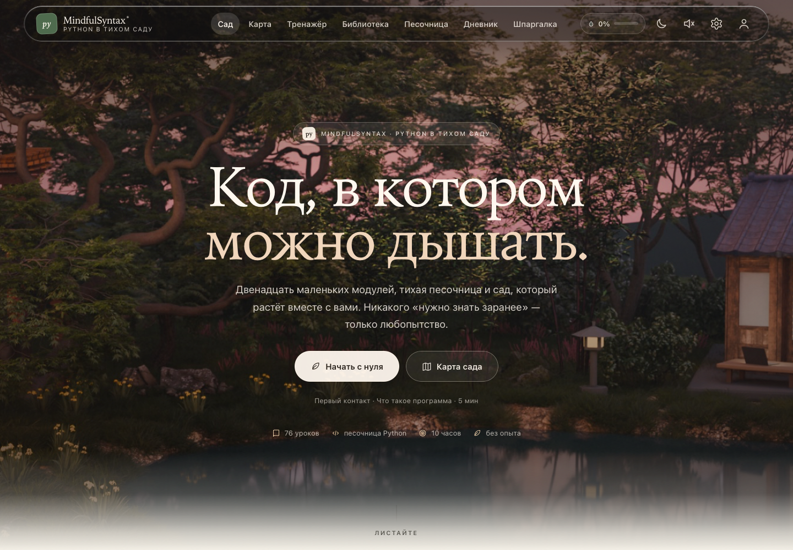
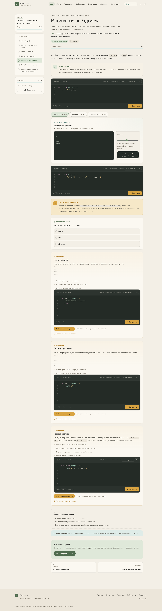
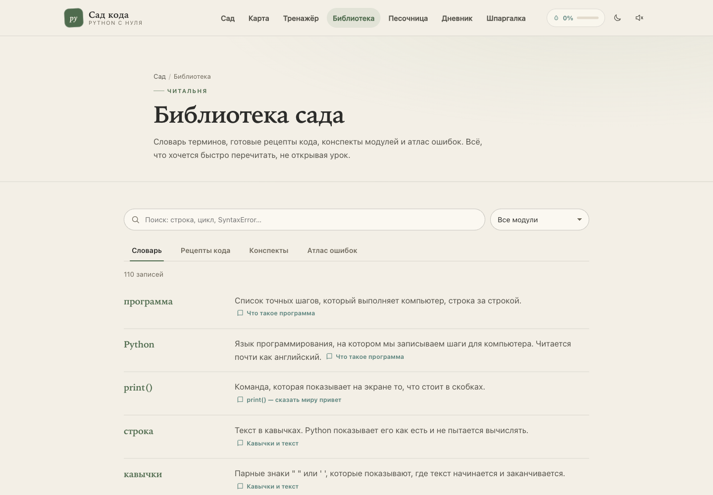
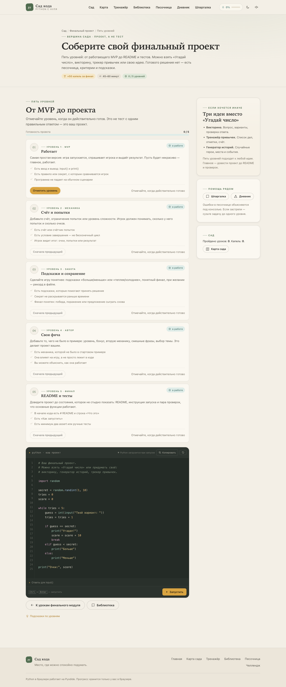

# Сад кода · Python с нуля

Спокойный интерактивный курс Python для человека, который **никогда не программировал**.
12 модулей, 76 уроков, 179 упражнений, настоящий Python в браузере и мини-игры
в эстетике японского сада: бамбук, камень, вода и утренний свет.



<details>
<summary>Ещё скриншоты</summary>








</details>

---

## Быстрый запуск

Сайт статический, сборка не нужна. Но открывать его через `file://` нельзя: браузеры
не разрешают ES-модули и Web Worker с локального файла. Нужна простая статическая раздача.

```bash
cd "/Users/klrt6/Documents/deepseek-harness/default-workspace/python-garden"
python3 -m http.server 4173
```

Откройте <http://localhost:4173>.

Альтернативы:

```bash
npx serve .
php -S localhost:4173
```

Требования: современный браузер с ES-модулями и Web Workers (Chrome, Edge, Firefox, Safari 16+).
Всё остальное — HTML, CSS и ES-модули без зависимостей и сборщика.

---

## Что внутри

### Учебный маршрут

| № | Модуль | Зона сада | Уроков |
|---|--------|-----------|--------|
| 1 | Первый контакт | Тропа у ворот | 6 |
| 2 | Переменные — коробки с надписями | Каменный сад | 6 |
| 3 | Ветвление — развилка на дороге | Развилка троп | 6 |
| 4 | Циклы — повторяем, пока не надоест | Бамбуковая роща | 7 |
| 5 | Списки и словари | Пруд с карпами | 6 |
| 6 | Функции — маленькие помощники | Чайный домик | 7 |
| 7 | Библиотеки и зависимости | Кладовая инструментов | 6 |
| 8 | Мини-проект: «Угадай число» | Фонарь игры | 6 |
| 9 | Ошибки и отладка | Мостик через ручей | 6 |
| 10 | Текст и файлы | Свиток | 7 |
| 11 | Проекты и разбор кода | Мастерская | 7 |
| 12 | Финальный проект | Вершина сада | 6 |

Каждый модуль заканчивается проектом или челленджем, который использует только
пройденный материал. Теория подаётся порциями, сразу после неё — практика.

### Возможности

- **Песочница Python** — настоящий Pyodide в Web Worker: `print`, `input`, условия,
  циклы, списки, словари, функции, `random`, `math`, `datetime`, файлы.
  Код можно остановить по таймауту, не подвешивая страницу.
- **Редактор** с подсветкой синтаксиса, номерами строк, `Tab`, автоотступом после
  двоеточия и запуском по `Ctrl/Cmd + Enter`.
- **Понятные ошибки** — `SyntaxError`, `NameError`, `IndentationError` и другие
  переводятся на простой русский; история хранится в **дневнике ошибок**.
- **Библиотека сада** — словарь на 110 терминов, 50 рецептов кода, атлас из 37
  разобранных ошибок и конспекты модулей.
- **Тренажёр** — 179 упражнений: предскажи вывод, прочитай код, найди ошибку,
  допиши строку, собери код. С фильтрами и повторением карточек.
- **Игры** — «Собери код», «Найди ошибку», «Угадай число», переменная-коробка,
  список покупок, симуляция pip, ёлочка; у игр есть уровни.
- **Карта сада** — 12 зон; пройденные модули расцветают. На телефоне — вертикальная карта.
- **25 достижений** — спокойные отметки пути, без рейтингов и давления.
- **День и ночь** — две палитры сада, без неона.
- **Звук** — синтезированные капли и деревянный «ток», по умолчанию выключен.
- **Аккаунт** — локальная регистрация/вход по email и паролю, прогресс и достижения
  в профиле. Уроки и модули открываются после входа, карта и остальное — свободно.
- **Приватность** — экран политики и обязательное согласие при регистрации.

---

## Скриншоты и дизайн-документация

- [DESIGN_BRIEF.md](./DESIGN_BRIEF.md) — полное описание продукта, идеи, палитры,
  страниц, компонентов, 3D, доступности и критериев редизайна.
- [INTERACTION_GUIDE.md](./INTERACTION_GUIDE.md) — принципы отклика, жестов,
  пружин, материалов и reduced motion, адаптированные под сад.
- [CONTENT_EXPANSION.md](./CONTENT_EXPANSION.md) — план расширения курса.
- [BLENDER_MODELS.md](./BLENDER_MODELS.md) — манифест 3D-моделей.
- [SUPABASE_SETUP.md](./SUPABASE_SETUP.md) — как создать проект, выполнить SQL,
  включить Discord и подключить базу.
- [CLAUDE_CODE_PROMPT.md](./CLAUDE_CODE_PROMPT.md) — исторический промт расширения
  (уже выполнен); актуальные цифры и проверки — в этом README.
- [MINDFULSYNTAX_PROMPT.md](./MINDFULSYNTAX_PROMPT.md) — новый промт редизайна:
  кинематографичный вечерний сад, 3D-сцена, карта и иконки.
- [MINDFULSYNTAX_SPEC.md](./MINDFULSYNTAX_SPEC.md) — визуальная спецификация
  MindfulSyntax®: темы Night/Sunset, токены, ассеты и критерии приёмки.
- [MINDFULSYNTAX_BUDGET_PROMPT.md](./MINDFULSYNTAX_BUDGET_PROMPT.md) — версия
  промта для бюджета $15–45: без real-time 3D и полной 3D-карты.
- [CLAUDE_CODE_BUDGET_PLAYBOOK.md](./CLAUDE_CODE_BUDGET_PLAYBOOK.md) — как писать
  запросы, чтобы Claude Code не вышел за бюджет.
- [MINDFULSYNTAX_READY_PROMPT.md](./MINDFULSYNTAX_READY_PROMPT.md) — готовый
  copy-paste промт для первого сообщения в Claude Code.
- [MINDFULSYNTAX_15_PROMPT.md](./MINDFULSYNTAX_15_PROMPT.md) — жёсткая версия
  ровно на $15: только hero, без карты и остальных страниц.
- [MINDFULSYNTAX_FULL_READY_PROMPT.md](./MINDFULSYNTAX_FULL_READY_PROMPT.md) —
  готовый промт для полного редизайна: 3D-сад, карта, иконки, все страницы.

---

## Архитектура

```
python-garden/
├── index.html                 # каркас, SVG-спрайт иконок, шапка, шпаргалка
├── css/
│   ├── tokens.css             # палитры дня/ночи, типографика, тени, движение
│   ├── base.css               # сброс, доступность, печать
│   ├── layout.css             # шапка, герой, подвал, сетки
│   ├── components.css         # кнопки, карточки, прогресс, drawer, тосты
│   ├── lessons.css            # урок, проза, код, песочница, квиз, задание
│   ├── games.css              # игры и интерактивные виджеты
│   ├── views.css              # карта, модуль, челлендж, главная
│   └── library.css            # библиотека и тренажёр
├── js/
│   ├── app.js                 # hash-роутер, тема, звук, шапка, auth-гард
│   ├── account.js             # Supabase-аккаунт или локальный fallback
│   ├── supabase.js            # REST-клиент Supabase Auth/PostgREST
│   ├── supabase-config.js     # URL и anon key проекта
│   ├── legal-config.js        # реквизиты оператора
│   ├── state.js               # прогресс, капли, достижения, повторение
│   ├── achievements.js        # 25 достижений
│   ├── audio.js               # WebAudio: капли, камень, перезвон
│   ├── ui.js                  # тосты, drawer, иконки, reveal
│   ├── syntax.js              # подсветка Python без внешних библиотек
│   ├── editor.js              # textarea + подсвеченный слой
│   ├── checks.js              # проверка заданий по коду и выводу
│   ├── sandbox.js             # песочница: запуск, консоль, объяснение ошибок
│   ├── runner.js              # Pyodide в Worker, таймауты, демо-режим
│   ├── pyodide-worker.js      # поток Python
│   ├── virtual-run.js         # офлайн-демо для простых примеров
│   ├── errors.js              # перевод ошибок Python на человеческий
│   ├── map.js                 # SVG-карта на 12 зон
│   ├── views/                 # home, module, lesson, map, library, practice,
│   │                          # playground, journal, challenge, cheatsheet,
│   │                          # account, auth, settings, privacy
│   ├── games/                 # игры, включая levels.js
│   └── data/                  # модули 01–12, библиотека, шпаргалка
├── vendor/
│   └── pyodide/               # Pyodide 0.26.4 (локально, офлайн)
├── assets/
│   ├── hero/                  # фоны и превью карты
│   ├── map-icons/             # 3D-миниатюры зон
│   ├── table-props/           # стол и свиток карты
│   ├── preview-*.png
│   └── favicon.svg
├── tools/
│   ├── CONTENT_BRIEF.md       # правила авторства контента
│   ├── validate-content.mjs   # проверка уроков, заданий и библиотеки в Pyodide
│   └── build-atlas.mjs
├── package.json
├── THIRD_PARTY_NOTICES.md
└── README.md
```

### Как это работает

- **Роутер** — обычный `hashchange`: `#/`, `#/map`, `#/module/m4`, `#/lesson/m4-l3`,
  `#/library`, `#/practice`, `#/playground`, `#/journal`, `#/challenge`,
  `#/account`, `#/login`, `#/register`, `#/reset`, `#/settings`, `#/privacy`.
- **Состояние** — один объект в `localStorage` под ключом `garden-of-code:v1`:
  пройденные уроки и шаги, капли активности, достижения, тема, звук, последние 30 ошибок,
  упражнения тренажёра, карточки повторения и уровни финального проекта.
- **Аккаунты** — Supabase Auth + Postgres, если заполнены `js/supabase-config.js`;
  иначе локальный fallback. Уроки и модули закрыты до входа; остальные страницы доступны.
  Пароли хеширует Supabase, прогресс хранится в JSONB-поле `profiles.progress`.
- **Pyodide** лежит в `vendor/pyodide/` и запускается в module-worker. Первый запуск
  читает ~13 МБ локальных файлов, дальше Python остаётся в памяти. Бесконечный цикл
  останавливается через 15 секунд вместе с воркером.
- **Демо-режим** — если Worker или WebAssembly недоступны, простые примеры
  (`print`, переменные, числа, строки, `input`) выполняет маленький JS-интерпретатор.
- **3D-сцена** — старый 3D-сад и все Three.js-исходники убраны из рабочей версии.
  Они сохранены в архиве `../versions/v2/`; текущая версия не загружает WebGL.
- **Звук** — только WebAudio, без файлов; включается кнопкой.

### Проверка контента

```bash
node tools/validate-content.mjs
```

Валидатор проверяет структуру 76 уроков, запускает 143 примера в Pyodide, проверяет
квизы, честность стартового кода, эталонные решения заданий, 179 упражнений,
рецепты и атлас ошибок. Текущий результат — **0 ошибок, 0 предупреждений**.

---

## Плагины DeepSeek Harness

Проверка выполнялась через `plugin_manager` в профиле `desktop`:

- ни один из перечисленных плагинов (`threejs-editor-mcp`, `dsh-3d-model-studio`,
  `dsh-genui`, `dsh-intelligent-ui`, `dsh-minigame-plugin`, `@vibe-x/dsh-html-workbench`,
  `dsh-qiuya-tools`) в профиле **не установлен**;
- `threejs-editor-mcp` в доступном каталоге не найден;
- сайт не зависит от них: Three.js, Pyodide и Blender-модели лежат локально.

---

## Проверено

- [x] 12 модулей и 76 уроков открываются без ошибок в консоли.
- [x] 179 упражнений, 110 терминов, 50 рецептов, 37 ошибок в атласе.
- [x] Pyodide выполняет `print`, `input`, условия, циклы, списки, функции, `random`, файлы.
- [x] Бесконечный `while True` останавливается по таймауту, воркер перезапускается.
- [x] `SyntaxError` объясняется простыми словами и попадает в дневник.
- [x] Задания, квизы, игры, тренажёр и финальный проект засчитываются и сохраняются.
- [x] Библиотека: вкладки, поиск и копирование работают.
- [x] Карта на 12 зон; пройденные зоны расцветают.
- [x] Аккаунт, вход/регистрация, защита уроков и модулей.
- [x] WebKit, Firefox и Chromium: вход, аккаунт, защита урока.
- [x] Тёмная и светлая темы, переключение без перезагрузки.
- [x] Desktop 1440, планшет 1024/920/768, мобильный 390/360: без горизонтального переполнения.
- [x] `prefers-reduced-motion` отключает анимации и параллакс.
- [x] WebKit (движок Safari), Firefox и Chromium: базовые маршруты и защита урока.

---

## Известные ограничения

- Первый запуск Python читает ~13 МБ из `vendor/pyodide/`. Это локальные файлы,
  но на медленном диске загрузка займёт пару секунд.
- `pip` в браузере не запускается: урок про установку — **учебная симуляция**.
- Файлы в уроках живут в виртуальной файловой системе Pyodide и не сохраняются
  между перезапусками страницы.
- 3D-сад убран из аккаунта; старые Three.js-артефакты лежат в архиве.
- Капли — счётчик активности, они больше не влияют на сад.
- При локальном fallback прогресс хранится только в браузере. При Supabase —
  в облачной базе; для публикации в РФ потребуется перенос базы в РФ.
- Supabase Free подходит для MVP до ~100 пользователей, но может засыпать после простоя.
- Финальный проект отмечается по уровням вручную: это проект, а не тест.

---

## Лицензии

Код сайта — MIT. Сторонние компоненты: Pyodide (MPL-2.0), Three.js (MIT),
Blender-модели — оригинальные работы проекта. Подробности — в
[THIRD_PARTY_NOTICES.md](./THIRD_PARTY_NOTICES.md).
